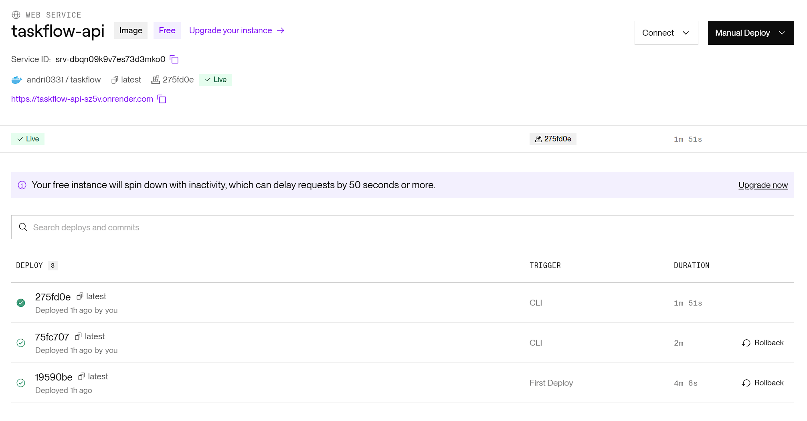
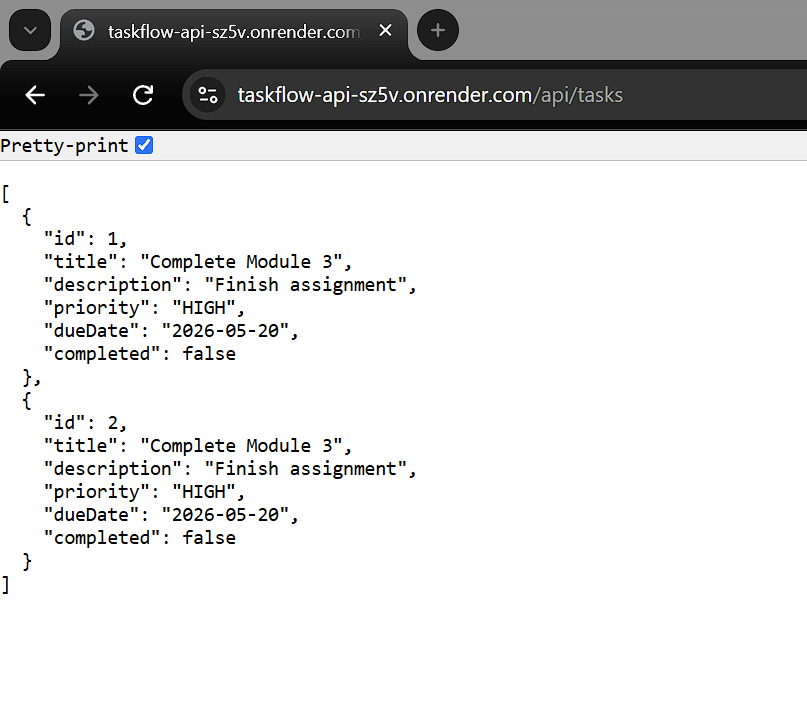
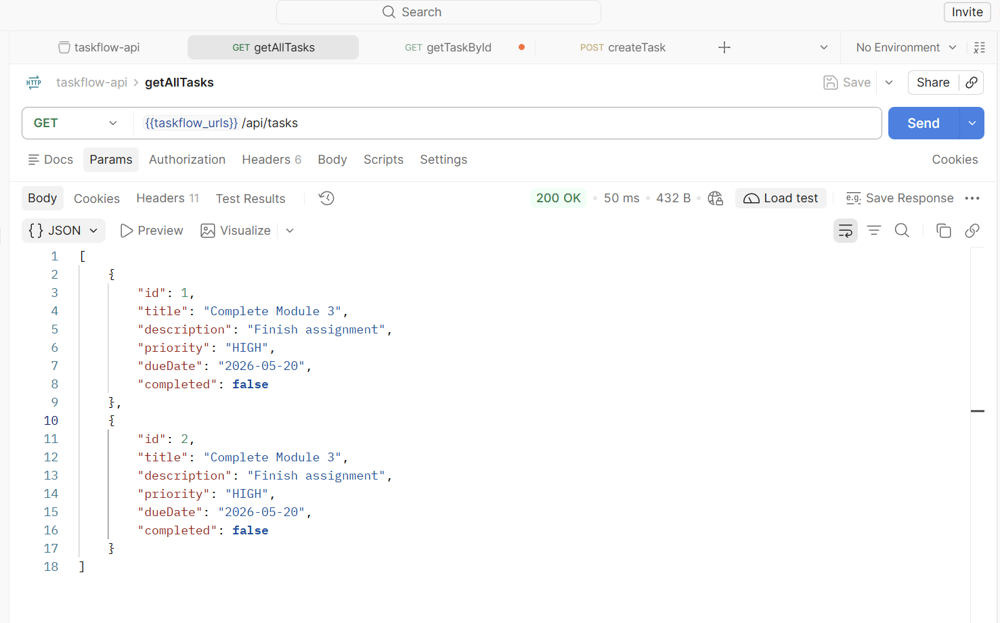
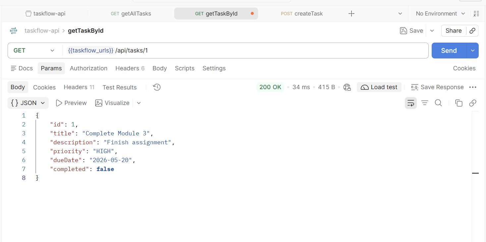
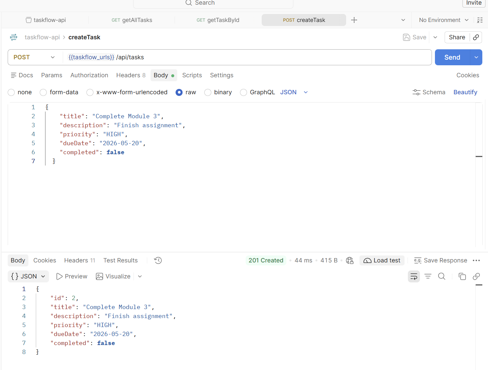
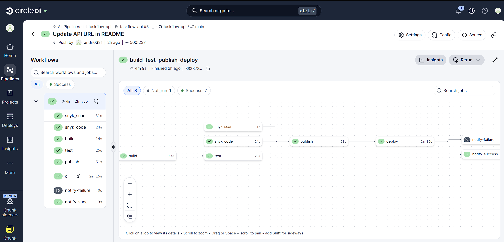
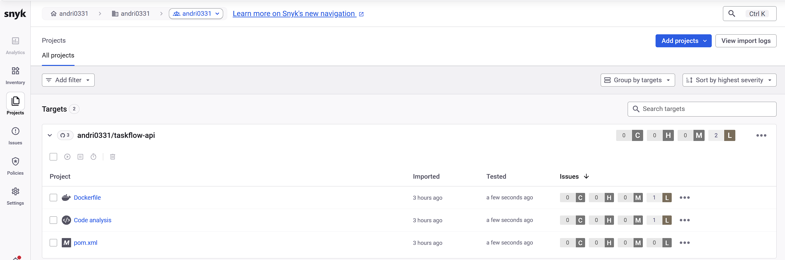
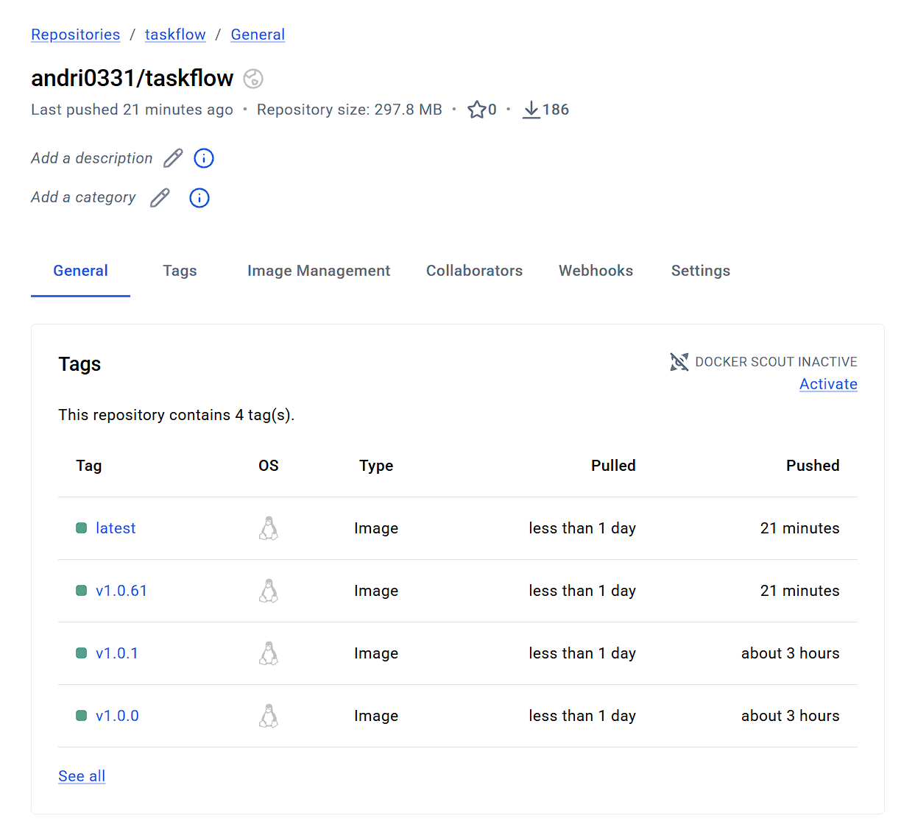

# TaskFlow API

A simple task management REST API built with Spring Boot. This is the sample project for the **Module 4 - End of Module Assignment**. Refer to the assignment instructions in **NTULearn** for the full list of tasks.

## Assignment submission

> [!IMPORTANT]
> **Submit your GitHub repository link to NTULearn.** This is the only thing you submit there - your live URL, screenshots and notes all go in this `README.md`.

Fill in each section below, then commit and push this `README.md` to your GitHub repository.

### Live application URL

Your TaskFlow API deployed on Railway:

```
https://taskflow-api-sz5v.onrender.com/api/tasks
```

### Screenshot: Render dashboard

Your Render dashboard showing the active deployment. Save the image in the `screenshots/` folder and update the file name below if needed.



### Screenshot: Live application

Your live Render URL returning task data (in your browser or terminal).






### Errors and failures

If you didn't complete every task, list what you completed, what went wrong, and the error messages you saw. If everything worked, write "None".

```
None
```

### Stretch goal (optional)

Which stretch goal you chose (if any), what you built, and any links (for example, your frontend URL, CI pipeline run or Docker Hub tags).

```
Stretch goal: CircleCI & Snyk
Links: https://app.circleci.com/workflow/88387328-91d6-46d5-b771-3d651e46ab0d
Notes: CicleCI and Security check with snyk
* There a critical vurnerability found that cannot be resolved, so added to ignore to allow success deployment
* Update the code using OpenCode to fix medium code testing
* low vurnerability ignored
```



```
Stretch goal: PUBLISH VERSIONED DOCKER IMAGES
Notes: minor version number generated by circleci and autotag to latest
```



## Getting started

### Prerequisites

- Java 21
- Maven (or use the included Maven Wrapper)

### Running the Application

From the project root:

```bash
./mvnw spring-boot:run
```

On Windows:

```bash
mvnw.cmd spring-boot:run
```

The application starts on `http://localhost:8080`.

### API Routes

| Method | Path              | Description             | Request Body | Success Response |
|--------|-------------------|--------------------------|---------------|-------------------|
| GET    | `/api/tasks`      | Get all tasks            | —             | `200 OK`          |
| GET    | `/api/tasks/{id}` | Get a single task by ID  | —             | `200 OK`          |
| POST   | `/api/tasks`      | Create a new task        | Task JSON     | `201 Created`     |

### Testing the API

Task creation accepts only `title`, `description`, `priority`, `dueDate`, and
`completed`. The server generates `id`; supplying it or any unknown field returns
`400 Bad Request`. Omitting `completed` defaults it to `false`.

Create a task:

```bash
curl -X POST http://localhost:8080/api/tasks \
  -H "Content-Type: application/json" \
  -d '{
    "title": "Complete Module 3",
    "description": "Finish assignment",
    "priority": "HIGH",
    "dueDate": "2026-05-20",
    "completed": false
  }'
```

Get all tasks:

```bash
curl http://localhost:8080/api/tasks
```

Get a task by ID:

```bash
curl http://localhost:8080/api/tasks/1
```

### H2 Database Console

While the app is running, the H2 console is available at `http://localhost:8080/h2-console`.

Use the following connection settings:

- JDBC URL: `jdbc:h2:mem:taskflowdb`
- Username: `sa`
- Password: *(leave blank)*
